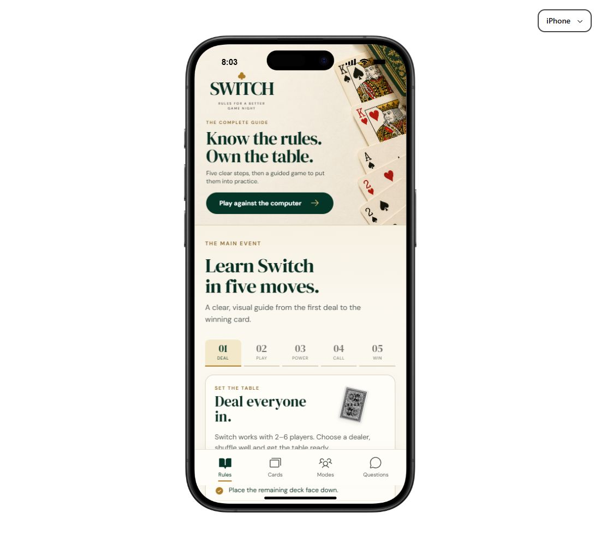

# Switch Card Game

A companion app for a physical Switch card night: score tracker, league tracker and stats tracker, plus an interactive rules guide and a guided tutorial game against the computer. The game itself is played with real cards.

## Source and release status

The `codex/switch-solo-hardening` branch is the focused development line for making the standalone Switch app dependable before any wider game-night product is considered. The public site is [switchcardgame.co.uk](https://switchcardgame.co.uk), but work on this branch does not deploy automatically and must not be treated as production until a separate release and rollback checklist is approved.

The multi-game Card Companion experiment remains outside this branch. Do not copy its seeded people, scores, matches, leagues, premium previews, or broader game catalogue into Switch.

## Current features

**Game-night companion**
- Score a night in several formats (head to head, domino, darts, league, knockout, cup)
- Reusable local player profiles, with honest stats derived only from saved nights: win rate, streaks, monthly wins, form, milestones, rivalries
- League seasons (3 points for a win, 1 for taking part) built from the nights you choose to count
- Club leaderboard with a crown, a nameable club, and one-tap shareable pictures (PNG) of a night, a league table or the leaderboard
- Night history, export, and a full backup file you can restore on a new phone
- Quick night: names, tap each round's winner, finish; saved to the same history and stats
- Everything stays on the device; there are no accounts
- Works offline after one visit (service worker in `public/sw.js`, production builds only)

**Learn the game**
- Interactive five-step rules guide, power-card reference and searchable questions
- Guided tutorial game against the computer with optional legal-move hints
- A coach that explains what each move meant and lists your options on every turn (`src/switch/coach.ts`, `CoachPanel` in `src/ui.tsx`); it only reads game state, so it can be reused for other games
- Games open on an ordinary card; matching sets can be played in any order; twos, eights, black kings, red-king counters, wild aces and the Last Card call are all enforced
- Tutorial finish leads to a real-cards setup checklist and straight into logging the night
- Twelve rules puzzles whose answers come from the real rules engine, with a streak and badge ladder (Rookie to Rules master)
- Rules help: quick-pick topic chips on the Questions tab; first-run welcome card; sounds and vibration (mutable)
- Add to phone button, web manifest and icons; privacy page at `/privacy.html`
- Reuse for other games: `src/kit` and `docs/REUSE-GUIDE.md`; store steps in `docs/store/PUBLISHING.md`

**Shell**
- Responsive iPhone and Pixel preview frames
- Demonstration advertising placements and an ad-free upgrade preview (development builds only)

## Run locally

```bash
npm install
npm run dev
```

## Validate

```bash
npm run check:runtime
npm run build
npm run test:sites
npm run test:runtime
npm run test:offline
```


