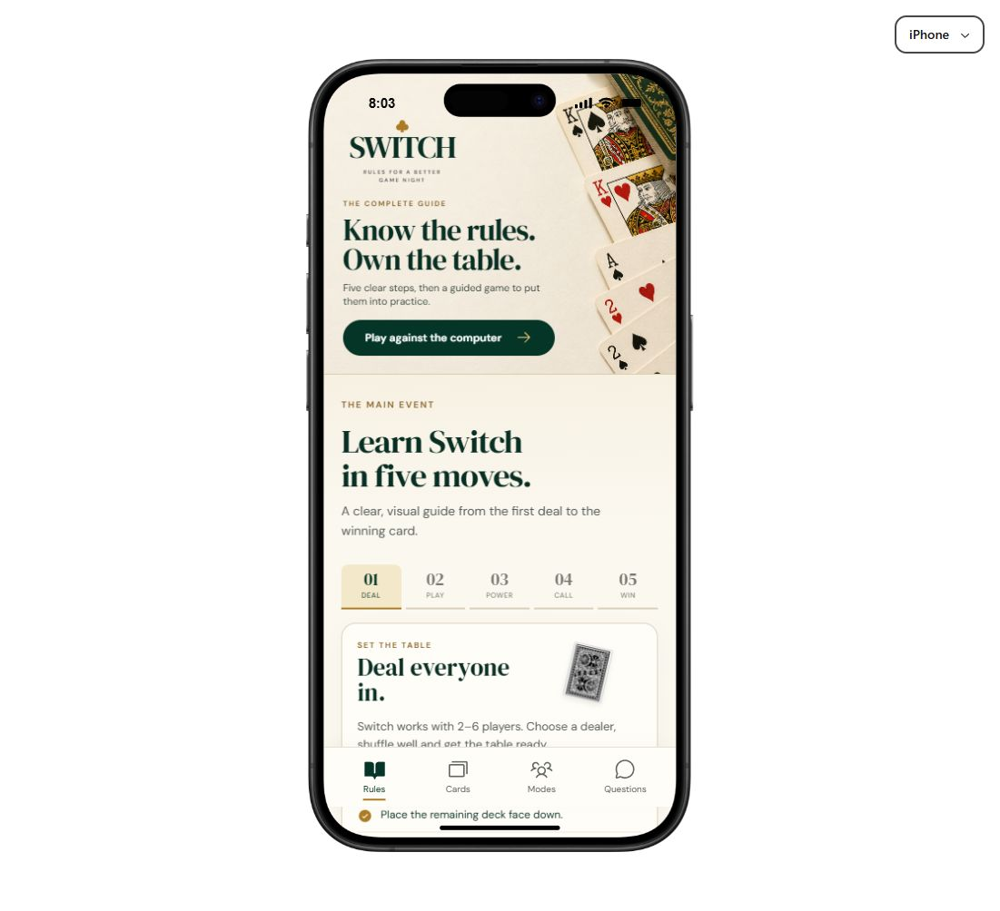

# Switch Card Game

A polished, mobile-first guide to the UK card game Switch, with an interactive rules story and a complete guided game against the computer.

## Current features

- Interactive five-step rules guide and searchable questions
- Full 52-card shuffled deck with no duplicate physical cards
- Draw-pile turnover without reshuffling when the pack is exhausted
- Guided computer opponent with optional legal-move hints
- Power-card chains for twos, eights, black kings and red-king counters
- Tactical choice to pick up instead of playing a legal card
- Wild aces with suit selection
- Responsive iPhone and Pixel preview frames
- Demonstration advertising placements and an ad-free upgrade preview

## Run locally

```bash
npm install
npm run dev
```

## Validate

```bash
npm run build
npm run test:runtime
npm run test:sites
```


